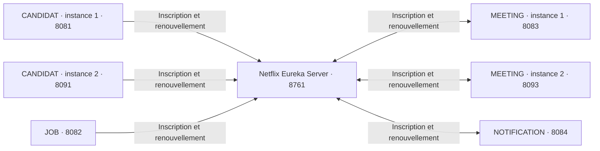
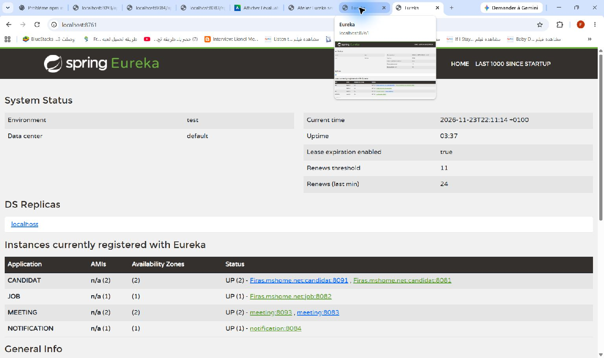

# JobBoard — Implémentation Eureka Server

Atelier **Architecture Web Distribuée (AWD)** · **ESPRIT 2026–2027**

Dépôt : <https://github.com/FCODE19503/JobBoard-Eureka-Microservices>.

Pour récupérer le projet dans PowerShell :

```powershell
git clone https://github.com/FCODE19503/JobBoard-Eureka-Microservices.git
Set-Location JobBoard-Eureka-Microservices
```

Les commandes détaillées plus bas utilisent le chemin de la machine de l'atelier. Sur une autre machine, remplacer `C:\Users\user\Desktop\backend\backend\microservices` par le chemin du clone. Le serveur se lance depuis `eureka-server/` ; Maven y est utilisable directement ou via `.\mvnw.cmd spring-boot:run`.

## 1. Présentation générale

JobBoard regroupe plusieurs API autour du recrutement. Candidat gère les candidats et leurs adresses ; Job gère les offres et leurs catégories. Meeting et Notification exposent actuellement un endpoint de salutation et une documentation OpenAPI ; leurs traitements métier restent à développer.

Cet atelier met en place un registre Netflix Eureka commun à des clients Java, Node.js et Python. Le résultat observé le **23 novembre 2026** comprend quatre applications et **six instances clientes UP**.

## 2. Objectifs pédagogiques

- Configurer un serveur de découverte de services.
- Enregistrer des clients de technologies différentes.
- Identifier les applications et distinguer leurs instances par leur port.
- Observer les inscriptions et renouvellements dans le dashboard.
- Vérifier les API indépendamment de leur présence dans le registre.

## 3. Architecture globale



Les liens représentent les échanges de découverte, pas le routage des appels métier. **Eureka est un registre de services, pas une API Gateway.** Les requêtes HTTP de cet atelier ciblent directement chaque microservice. Aucune communication métier entre services ni répartition de charge n'est démontrée ici.

Arborescence utile :

```text
microservices/
├── README.md
├── eureka-server/            # Serveur Netflix Eureka et Maven Wrapper
├── candidat/                 # Spring Boot, candidats et adresses
├── job/                      # Spring Boot, offres et catégories
├── meeting/                  # Express et eureka-js-client
├── notification/             # FastAPI et py-eureka-client
├── canditature/              # Autre projet présent, hors périmètre validé
├── Database/                 # Données locales existantes
└── docs/screenshots/eureka-dashboard.png
```

Le serveur est inclus dans [eureka-server/](eureka-server/). Ses sources ont été copiées depuis le projet local `test_spring\Euroka`, qui reste intact à son emplacement original.

## 4. Microservices, technologies et ports

| Application | Technologies constatées | Ports | Instances observées |
|---|---|---|---|
| Eureka Server | Spring Boot **4.1.2**, Spring Cloud **2025.1.4**, Java cible 17 | 8761 | Serveur accessible |
| CANDIDAT | Spring Boot **3.2.5**, Spring Cloud **2023.0.4**, Java 17, JPA, H2 | **8081, 8091** | **UP (2)** |
| JOB | Spring Boot **3.2.5**, Spring Cloud **2023.0.4**, Java 17, JPA, MySQL | 8082 | **UP (1)** |
| MEETING | Node.js, Express **^5.1.0**, eureka-js-client **^4.5.0**, swagger-ui-express **^5.0.1** | **8083, 8093** | **UP (2)** |
| NOTIFICATION | Python, FastAPI, Uvicorn, py-eureka-client | 8084 | **UP (1)** |
| **Total des clients** | **4 applications** | **6 ports clients distincts** | **6 instances UP** |

Les versions Java et Spring proviennent des `pom.xml`, les contraintes Node de `meeting/package.json`. Springdoc vaut **2.5.0** pour Candidat et Job ; les versions H2 et du connecteur MySQL sont gérées par Maven. Les anciens README des sous-projets sont conservés mais certaines indications sont dépassées : les sources et configurations font référence.

Dans `notification/requirements.txt` : `fastapi>=0.115`, `uvicorn[standard]>=0.30`, `py-eureka-client` sans version figée. L'environnement local inspecté contient Python **3.13.14**, FastAPI **0.163.1**, Uvicorn **0.54.0** et py-eureka-client **0.13.3**. Ce relevé local ne constitue pas un verrouillage des dépendances.

## 5. Fonctionnement du Service Discovery

Au démarrage, chaque client publie son nom d'application, son adresse et son port auprès de `http://localhost:8761/eureka`. Les renouvellements périodiques entretiennent son inscription. Le registre regroupe les instances partageant un nom d'application ; ainsi CANDIDAT et MEETING apparaissent chacun avec deux instances.

Les clients sont configurés pour récupérer le registre. Cette capacité ne prouve pas qu'un appel métier utilise effectivement la découverte. Le statut `UP` atteste de l'état déclaré dans Eureka ; il ne remplace pas un test HTTP de l'API ou de sa base de données. Une inscription peut rester visible un certain temps après une panne, jusqu'à l'expiration du bail et selon les mécanismes de protection du registre.

## 6. Configuration du serveur Eureka

Projet du dépôt : [eureka-server/pom.xml](eureka-server/pom.xml). Les fichiers nécessaires ont été copiés à l'identique depuis le projet Euroka original.

- Point d'entrée : `src/main/java/com/example/euroka/EurokaApplication.java`.
- Annotations : `@SpringBootApplication` et `@EnableEurekaServer`.
- Dépendance : `org.springframework.cloud:spring-cloud-starter-netflix-eureka-server`.
- BOM Maven : `org.springframework.cloud:spring-cloud-dependencies:2025.1.4`.

Configuration réelle de `src/main/resources/application.properties` :

```properties
spring.application.name=eureka
server.port=8761
eureka.client.register-with-eureka=false
eureka.client.fetch-registry=false
```

Le serveur ne s'enregistre pas lui-même comme client et ne récupère pas le registre d'un autre serveur. Dashboard : <http://localhost:8761/> ; registre JSON : <http://localhost:8761/eureka/apps> avec l'en-tête `Accept: application/json`.

## 7. Clients Spring Boot : Candidat et Job

Les deux projets déclarent `spring-cloud-starter-netflix-eureka-client`, avec le BOM Spring Cloud **2023.0.4**. Leurs classes principales portent `@EnableDiscoveryClient` :

- `com.awd.candidat.CandidatApplication` ;
- `com.awd.job.JobApplication`.

Extrait commun des configurations :

```properties
eureka.client.service-url.defaultZone=http://localhost:8761/eureka
eureka.client.register-with-eureka=true
eureka.client.fetch-registry=true
eureka.instance.prefer-ip-address=true
```

`spring.application.name` vaut respectivement `candidat` et `job`, et `server.port` vaut 8081 et 8082. Les noms apparaissent en majuscules dans le dashboard.

**Candidat / H2.** URL configurée : `jdbc:h2:file:./Database/Data/Candidat`, relative au répertoire de lancement. Console : `/h2`. `spring.jpa.hibernate.ddl-auto=create` recrée le schéma au démarrage : préserver les données utiles avant tout redémarrage. Deux processus ne doivent pas ouvrir simultanément ce même fichier H2 avec la configuration actuelle.

**Job / MySQL.** Connexion à `localhost:3306`, base `job_db`, pilote `com.mysql.cj.jdbc.Driver`. L'URL active comporte `createDatabaseIfNotExist=true`, `useSSL=false`, `allowPublicKeyRetrieval=true` et `serverTimezone=UTC`. `spring.jpa.hibernate.ddl-auto=none` : Hibernate ne crée pas les tables. Le script [job/database/job_db.sql](job/database/job_db.sql) existe, mais contient des `DROP TABLE` : son import est réservé à une base de démonstration neuve et n'est pas une étape à répéter sur les données existantes.

Les identifiants ne sont pas reproduits ici. Pour une autre installation, les propriétés Spring peuvent être fournies via `SPRING_DATASOURCE_USERNAME` et `SPRING_DATASOURCE_PASSWORD` dans l'environnement local.

## 8. Meeting : intégration eureka-js-client

`meeting/src/server.js` importe l'application Express depuis `src/app.js`, puis construit un client `Eureka` :

| Paramètre | Valeur réelle |
|---|---|
| Port HTTP | `Number(process.env.PORT || 8083)` |
| Application | `MEETING` |
| Identifiant d'instance | `meeting:${PORT}` |
| Hôte et IP annoncés | `127.0.0.1` |
| Serveur Eureka | `localhost:8761` |
| Chemin Eureka | `/eureka/apps/` |
| Inscription / récupération du registre | `true` / `true` |
| URL de statut et de santé | `/api/meetings/hello` sur le port de l'instance |

Le client démarre dans le callback de `app.listen`. Les signaux `SIGINT` et `SIGTERM` déclenchent `client.stop`, puis la fermeture du serveur HTTP. Les deux ports produisent des identifiants distincts et permettent de conserver les deux inscriptions.

## 9. Notification : py-eureka-client et lifespan FastAPI

Point d'entrée : `notification/app/main.py`, objet ASGI `app`. Le contexte `lifespan`, créé avec `@asynccontextmanager`, attend `eureka_client.init_async(...)` avant de céder la main à FastAPI. Le bloc `finally` attend `client.stop()` à la fermeture.

| Paramètre | Valeur réelle |
|---|---|
| `PORT` | Variable d'environnement, défaut `8084` |
| `EUREKA_URL` | Variable d'environnement, défaut `http://localhost:8761/eureka` |
| Application | `NOTIFICATION` |
| Identifiant | `notification:{PORT}` |
| Hôte et IP annoncés | `127.0.0.1` |
| URL de statut et de santé | `/api/notifications/hello` |

Le port annoncé à Eureka provient de `PORT`, tandis que le port d'écoute en ligne de commande provient de `uvicorn --port`. **Ces deux valeurs doivent correspondre.** Aucun stockage ni envoi réel de notifications n'est implémenté.

## 10. Installation des prérequis

Préparer sous Windows un **JDK 17**, Maven, **Node.js >=18** avec npm, Python et un serveur MySQL accessible sur le port 3306. Python 3.13.14 est présent dans le venv inspecté ; aucune borne minimale Python n'est déclarée par ce projet. La version du serveur MySQL n'a pas été vérifiée.

Installer ces outils depuis les distributions de leurs éditeurs, puis vérifier leur disponibilité dans PowerShell :

```powershell
java -version
mvn --version
node --version
npm --version
python --version
mysql --version
```

Relevé local : Maven **3.9.14**, JDK utilisé par Maven **17.0.18**, Node.js **24.15.0**. Les versions du serveur Eureka et des clients Spring diffèrent ; elles sont documentées telles que déclarées, sans migration effectuée.

Sur une installation neuve uniquement, préparer les dépendances applicatives :

```powershell
Set-Location 'C:\Users\user\Desktop\backend\backend\microservices\meeting'
npm ci

Set-Location 'C:\Users\user\Desktop\backend\backend\microservices\notification'
python -m venv venv
.\venv\Scripts\python.exe -m pip install -r requirements.txt
```

Maven résout les dépendances lors de ses commandes. Ces étapes d'installation sont des instructions pour la reproduction ; aucune dépendance n'a été installée pour rédiger ce document. Pour Job, utiliser une base déjà préparée ; si une base neuve doit être initialisée, examiner le script SQL puis l'importer dans MySQL Workbench. Aucune opération SQL n'a été exécutée pour cette documentation.

## 11. Démarrage des microservices

Chaque bloc se lance dans **un terminal PowerShell distinct**. Démarrer Eureka, vérifier MySQL, puis lancer les clients. Les services déjà en cours d'exécution n'ont pas à être relancés : les commandes ci-dessous occuperaient les mêmes ports.

### Eureka Server — 8761

```powershell
Set-Location 'C:\Users\user\Desktop\backend\backend\microservices\eureka-server'
mvn spring-boot:run
```

### Candidat — 8081

```powershell
Set-Location 'C:\Users\user\Desktop\backend\backend\microservices\candidat'
mvn spring-boot:run
```

Cette commande utilise H2 fichier et le mode `create` décrits en section 7.

### Job — 8082

```powershell
Set-Location 'C:\Users\user\Desktop\backend\backend\microservices\job'
mvn spring-boot:run
```

MySQL et les tables de `job_db` doivent être disponibles au préalable.

### Meeting — 8083

```powershell
Set-Location 'C:\Users\user\Desktop\backend\backend\microservices\meeting'
$env:PORT=8083
npm start
```

### Notification — 8084

```powershell
Set-Location 'C:\Users\user\Desktop\backend\backend\microservices\notification'
$env:PORT=8084
$env:EUREKA_URL='http://localhost:8761/eureka'
.\venv\Scripts\Activate.ps1
uvicorn app.main:app --reload --port 8084
```

Si l'activation du venv est indisponible, utiliser directement son interpréteur, sans modifier les paramètres système :

```powershell
.\venv\Scripts\python.exe -m uvicorn app.main:app --reload --port 8084
```

`--reload` convient à l'atelier local. Les variables `$env:...` définies ici s'appliquent au terminal courant et aux processus qu'il lance.

## 12. Lancement de plusieurs instances

### Deuxième Candidat — 8091

Dans un autre terminal, fournir une base H2 **en mémoire distincte**, limitée à la démonstration. Cette surcharge de lancement évite de toucher au fichier de la première instance ; elle ne modifie aucun fichier de configuration :

```powershell
Set-Location 'C:\Users\user\Desktop\backend\backend\microservices\candidat'
mvn spring-boot:run '-Dspring-boot.run.arguments=--server.port=8091 --spring.datasource.url=jdbc:h2:mem:candidat8091'
```

Cette commande est une procédure de reproduction déduite des propriétés Spring, non un relevé de la commande ayant lancé l'instance déjà observée. Les deux instances ont des données indépendantes ; les données en mémoire disparaissent à l'arrêt.

### Deuxième Meeting — 8093

Dans un autre terminal :

```powershell
Set-Location 'C:\Users\user\Desktop\backend\backend\microservices\meeting'
$env:PORT=8093
npm start
```

Le dashboard doit afficher `CANDIDAT UP (2)`, `MEETING UP (2)`, `JOB UP (1)` et `NOTIFICATION UP (1)`. Changer un port d'écoute impose aussi de conserver un identifiant d'instance distinct et une adresse annoncée cohérente.

## 13. Endpoints et documentation Swagger

Les routes ci-dessous sont définies dans les sources. Leur présence ne signifie pas que chaque opération a été exécutée lors de la vérification documentaire.

| Service / port | Routes réellement implémentées | Swagger UI | OpenAPI |
|---|---|---|---|
| Candidat / 8081, 8091 | `/mic1/candidates`, `/mic1/addresses` | `/swagger-ui.html` | `/v3/api-docs` |
| Job / 8082 | `/api/jobs`, `/api/categories` | `/swagger-ui.html` | `/v3/api-docs` |
| Meeting / 8083, 8093 | `GET /api/meetings/hello` | `/swagger-ui/` | `/v3/api-docs` |
| Notification / 8084 | `GET /api/notifications/hello` | `/swagger-ui` | `/v3/api-docs` |

Préfixer les chemins par `http://localhost:<port>`. Notification expose aussi `/redoc` ; Candidat expose la console H2 à <http://localhost:8081/h2>.

| API | Opérations |
|---|---|
| `/mic1/candidates` | GET liste, POST création ; `/{id}` : GET, PUT, DELETE |
| `/mic1/candidates/{id}/address/{addressId}` | PUT association d'une adresse |
| `/mic1/candidates/{id}/address` | DELETE dissociation |
| `/mic1/addresses` | GET liste, POST ; `/{id}` : GET, PUT, DELETE |
| `/api/jobs` | GET avec filtres facultatifs `available`, `categoryId` ; POST ; `/{id}` : GET, PUT, DELETE |
| `/api/jobs/{id}/availability` | PATCH avec le paramètre `available` |
| `/api/categories` | GET, POST ; `/{id}` : GET, PUT, DELETE |
| `/api/categories/{id}/jobs` | GET offres d'une catégorie |

Les liens Java présents dans Eureka peuvent pointer vers `/actuator/info`. Les POM inspectés ne déclarent pas le starter Actuator : utiliser les routes API et Swagger ci-dessus pour vérifier les services.

## 14. Tests réalisés et résultats observés

Vérifications HTTP en lecture seule effectuées le **23 novembre 2026**, sans redémarrage des services :

| Contrôle | Résultat réellement observé |
|---|---|
| `GET http://localhost:8761/eureka/apps`, Accept JSON | 4 applications, 6 instances `UP` : 8081, 8091, 8082, 8083, 8093, 8084 |
| `GET http://localhost:8083/api/meetings/hello` | HTTP 200, `{"message":"hello I'm microservice meeting"}` |
| `GET http://localhost:8093/api/meetings/hello` | HTTP 200, même réponse Meeting |
| `GET http://localhost:8084/api/notifications/hello` | HTTP 200, `{"message":"hello I'm microservice notification"}` |
| Dashboard Eureka | Quatre applications et six instances visibles dans la capture |

Commandes PowerShell de contrôle :

```powershell
Invoke-RestMethod 'http://localhost:8761/eureka/apps' -Headers @{Accept='application/json'}
Invoke-RestMethod 'http://localhost:8083/api/meetings/hello'
Invoke-RestMethod 'http://localhost:8093/api/meetings/hello'
Invoke-RestMethod 'http://localhost:8084/api/notifications/hello'
```

Des suites automatisées existent, mais **n'ont pas été exécutées pour cette livraison documentaire** :

| Projet | Suite présente | État de vérification |
|---|---|---|
| Candidat | JUnit / MockMvc, 8 méthodes de test | Les tests ciblent encore `/api/candidates` et `/api/addresses`, tandis que les contrôleurs utilisent `/mic1/...` ; correction à prévoir |
| Job | JUnit / MockMvc, 7 méthodes de test | Configuration H2 en mémoire en mode MySQL dans `src/test/resources/application.properties` ; aucun succès revendiqué ici |
| Meeting | `npm test`, 4 tests HTTP | Hello, OpenAPI, Swagger et route inconnue ; aucune vérification d'inscription Eureka dans cette suite |
| Notification | `python -m pytest`, 4 tests HTTP | Hello, OpenAPI, Swagger et 404 ; le TestClient utilisé hors contexte ne teste pas le lifespan Eureka |

Les tests Candidat utilisent la configuration applicative et ne doivent pas être lancés contre le fichier H2 existant. Avant une exécution future, isoler la base en mémoire et désactiver les clients Eureka dans les tests. Les tests Job doivent aussi être isolés du registre de démonstration. Aucun résultat CRUD, de charge ou de bascule n'est inventé.

## 15. Capture du dashboard Eureka



Capture authentique du dashboard local réalisée pendant la finalisation de la documentation, le **23 novembre 2026**, avec l'heure serveur **22:11:14 +0100** affichée. Elle montre CANDIDAT et MEETING avec deux instances chacun, ainsi que JOB et NOTIFICATION avec une instance chacun. Elle complète la capture initiale fournie pour l'atelier ; aucune interface n'a été reconstituée.

## 16. Difficultés et solutions présentes dans le projet

Les éléments suivants décrivent les mécanismes constatés dans le code ; ils ne prétendent pas reconstituer un historique d'incidents non fourni.

| Point à traiter | Solution constatée ou procédure documentée |
|---|---|
| Clients de trois écosystèmes | Starter Spring Cloud, eureka-js-client et py-eureka-client utilisent le même registre |
| Deux Meeting portant le même nom | Identifiant `meeting:${PORT}` et ports distincts |
| Cycle de vie asynchrone FastAPI | `init_async` au démarrage et `await client.stop()` dans le `finally` du lifespan |
| Arrêt de Meeting | Gestion de SIGINT/SIGTERM et désinscription avant fermeture HTTP |
| Collision H2 entre deux Candidat | Base mémoire distincte dans la commande proposée pour 8091 |
| Dossier serveur annoncé introuvable | Chemin réel identifié : `test_spring\Euroka` |
| README secondaires et tests Candidat décalés | Documentation racine alignée sur les sources ; incohérences signalées, fichiers existants préservés |
| Port Notification annoncé différent du port Uvicorn | Définir `PORT=8084` et `--port 8084` ensemble |

## 17. Limites actuelles et améliorations possibles

- Meeting et Notification n'implémentent que leur endpoint hello ; leurs CRUD et traitements métier restent à réaliser.
- Aucun scénario d'appel métier par découverte, de répartition de charge ou de tolérance aux pannes n'a été validé.
- Eureka fonctionne sur un seul serveur local ; une réplication serait une évolution distincte.
- Les adresses locales annoncées conviennent à la machine de démonstration ; un déploiement réseau demanderait une configuration adaptée.
- Les données des deux Candidat ne sont pas partagées avec la procédure H2 proposée ; le mode `create` limite la conservation des données.
- Aligner les tests Candidat avec `/mic1/...`, puis ajouter des tests isolés d'inscription et de désinscription Eureka.
- Figer les dépendances Python et compléter la vérification des versions résolues et de MySQL pour renforcer la reproductibilité.
- Le serveur est inclus dans `eureka-server/` ; son projet original externe reste préservé.
- Préparer séparément la configuration de déploiement, la gestion des secrets et l'observabilité si le projet évolue au-delà de l'atelier local.

## 18. Membres de l'équipe

| Nom et prénom | Classe / groupe | Contribution |
|---|---|---|
| À compléter | À compléter | À compléter |
| À compléter | À compléter | À compléter |
| À compléter | À compléter | À compléter |

Adapter le nombre de lignes à l'équipe réelle, sans déduire les membres des métadonnées présentes dans les sources.

## 19. Conclusion

L'atelier démontre l'enregistrement de clients Spring Boot, Express et FastAPI dans Netflix Eureka. Le registre et la capture confirment quatre applications et six instances UP, dont deux Candidat et deux Meeting. Les endpoints hello Meeting et Notification répondent avec succès ; la découverte utilisée pour des appels métier et les fonctions métier encore absentes constituent les prochaines étapes.

Avant le rendu CC, compléter les membres de l'équipe et traiter les incohérences de tests signalées. Le serveur Eureka est inclus ; les bases locales, environnements, caches et fichiers privés sont exclus par le `.gitignore` racine.
